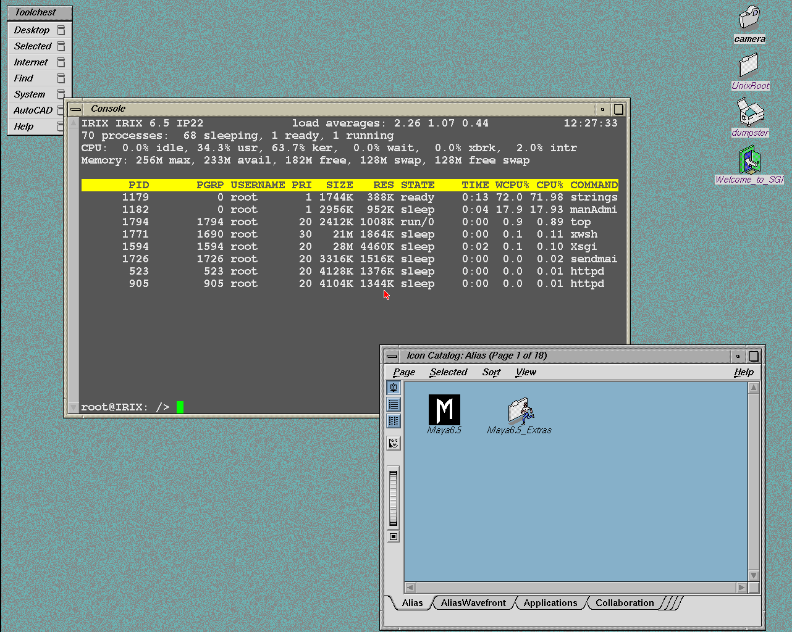
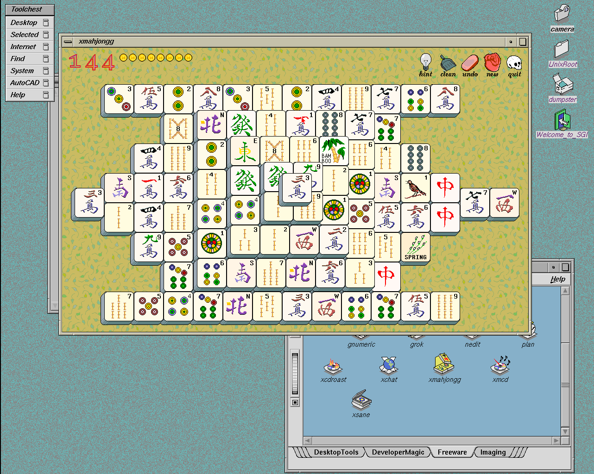

# Prismatic


Prismatic is the Rust/SDL3 frontend being developed for [our](https://github.com/salvogendut/iris) fork of [Iris](https://github.com/techomancer/iris),
following the desktop conventions of the Happy Years emulators
([1984](https://github.com/salvogendut/1984), [1985](https://github.com/salvogendut/1985),
[1986](https://github.com/salvogendut/1986), and [1989](https://github.com/salvogendut/1989)).

Prismatic supports SGI Indy, Indigo2, Indigo2 IMPACT, O2 and Octane models.
It opens **PAUSED** with a diskless Indy by default. Configure the machine in
**F9 > General**, attach disks or CDs in **Media**, then press **Ctrl+P** to boot.
Saved machine labels let you keep multiple configurations and switch with **F2**.

The SDL3 interface provides keyboard and mouse capture, guest audio, per-CPU
and storage activity LEDs, screenshots and GIF recording. Enable **General >
Tinker** for Advanced, Network and Extensions controls. Available features depend
on the linked Iris core and guest OS; unsupported controls are greyed out.

## Screenshots

IRIX 6.5 running in Prismatic, captured at the guest's native 1282×1024 resolution.





## Build and run

Use a Rust/SDL3 development environment with Git, Python 3 and the native build
libraries installed. Linux is the validated platform; see the
[build guide](docs/building.md#dependencies-and-features) for prerequisites.

```sh
make                          # Fetch/update Iris and build a release
./target/release/prismatic
# Or build and launch together:
make run
```

The defaults are [our Iris fork](https://github.com/salvogendut/iris) and its
**`xiri`** branch. Edit `IRIS_REPO` and `IRIS_BRANCH` in [Makefile](Makefile), or
override them for one build:

```sh
make IRIS_REPO=https://github.com/YOUR-NAME/iris.git IRIS_BRANCH=your-branch
```

Managed Iris sources live under `target/bootstrap`; an existing `../iris`
checkout stays independent. **F9 > About** shows the branch used to build the
executable. See [building and Iris compatibility](docs/building.md) for manual
Cargo builds, optional features and `main` compatibility.

## Essential controls

| Key | Action |
| --- | --- |
| Click guest display / Ctrl+Enter | Capture / release keyboard and mouse |
| Ctrl+P | Boot, pause or resume the selected machine |
| F2 | Cycle saved machine labels |
| F4 / F6 | Take a screenshot / start or stop GIF recording |
| F5 | Confirm a cold reset |
| F9 | Open options; save an open options session |
| Arrows / Enter / Escape | Navigate options, change a value, or close with Save/Discard choices |
| Tab / Shift+Tab | Switch topic sub-tabs in Advanced and Extensions; sub-tabs are also clickable |
| Ctrl+Plus / Ctrl+Minus | Change and save the window scale |
| F11 / F12 | Toggle fullscreen / confirm quit |

Menu settings apply after a successful Save; changes that restart a running
machine ask for confirmation. Settings persist in `prismatic.cfg`, normally
under `~/.local/share/prismatic/` on Linux. Shut down the guest OS before
restarting or quitting. See the [usage guide](docs/usage.md) for first-boot PROM
instructions, full shortcuts, input handling, capture options and audio.

## Documentation

| Guide | Contents |
| --- | --- |
| [Building and Iris compatibility](docs/building.md) | Dependencies, Makefile options, manual Cargo builds and core features |
| [Controls, captures and audio](docs/usage.md) | First launch, keyboard/mouse input, window scaling, screenshots, GIFs and sound |
| [Machine settings and saved labels](docs/machines.md) | Models, CPU/RAM, PROM boot/console presets, firmware and multiple instances |
| [Advanced settings](docs/advanced.md) | Performance, SGIEmu optimizations, serial TCP/PTY, GDB/VNC, tracing and diagnostics |
| [Extensions](docs/extensions.md) | Graphics, extra CPUs, optional devices, checkpoints, CD changer and scratch storage |
| [Media and activity LEDs](docs/media.md) | Disk/CD formats, SCSI IDs, copy-on-write overlays and status lights |
| [Networking and file sharing](docs/networking.md) | SSH through localhost port forwarding, NAT, PCAP, NFS, TFTP and RSH |
| [Configuration and saved state](docs/configuration.md) | `prismatic.cfg`, TOML examples, paths and persistent firmware state |
| [Testing and smoke checks](docs/testing.md) | Formatting, Clippy, unit tests, diskless PROM checks and coverage limits |
| [Integration architecture](docs/architecture.md) | Frontend/core boundaries, worker lifecycle, display/audio handoff and design details |

## Acknowledgments

Thank you to [techomancer](https://github.com/techomancer) and the contributors
to [Iris](https://github.com/techomancer/iris) for developing the SGI emulation
core that powers Prismatic. Their emulator, hardware research and documentation
provide the foundation for [our fork](https://github.com/salvogendut/iris) and
its integration with the Happy Years Rust/SDL3 interface.

Thank you also to [Renato Tarabella](https://github.com/RenatoTarabella) and the
[SGIEmu project](https://github.com/RenatoTarabella/SGIEmu). SGIEmu's JIT register
caching and real-time clock caching techniques inspired the optional performance
optimizations adapted into our Iris fork, now available in Prismatic through
**Advanced > Performance > SGIEmu optimizations**.
